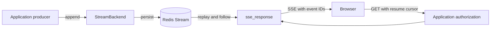

# Resumable events for fastapi-redis-sdk

Status: Draft contribution proposal.

Date: 2026-10-20.

Upstream baseline: [`redis/fastapi-redis-sdk` at `d72b1615`](https://github.com/redis/fastapi-redis-sdk/tree/d72b1615ce8b044e44a89a7130c4bb061814a003).

Add resumable server-sent events to `fastapi-redis-sdk`: applications append
events to Redis Streams, and HTTP clients replay and follow those events across
disconnects. A chat application is the reference example, but the feature also
serves notifications, progress updates, and other server-generated events.

The developer-facing API is `.streams()`, an injected `StreamBackendDep`, and
the HTTP helper `sse_response()`. Authentication and authorization remain
ordinary application-owned FastAPI dependencies. The feature introduces no agent
types, mandatory channel objects, tenant model, or authentication framework.

All stream APIs below are proposed additions, not available in the current
release. This is a design-only contribution for maintainer discussion. It does
not change runtime behavior, dependencies, or existing feature requirements.
The storage and transport guarantees below are implementation requirements;
the acceptance scenarios describe the evidence required before release.



## Developer experience

### Subscribe to chat events

```python
from fastapi import Depends, FastAPI, Request
from fastapi.sse import EventSourceResponse
from redis_fastapi import FastAPIRedis, StreamBackendDep, sse_response

from myapp.chats import Chat, require_chat_read_access

app = FastAPI()
FastAPIRedis(app).lifespan().streams()


@app.get("/chats/{chat_id}/events", response_class=EventSourceResponse)
async def chat_events(
    request: Request,
    streams: StreamBackendDep,
    chat: Chat = Depends(require_chat_read_access),
):
    return await sse_response(
        request,
        backend=streams,
        stream=f"chat:{chat.id}",
    )
```

The application dependency authenticates the caller, loads the chat, checks read
permission, and returns the authorized chat. The helper validates the resume
cursor, prepares the subscription, and returns an SSE response. Awaiting the
helper performs preparation; it does not wait for the chat to finish.

`Chat` and `require_chat_read_access` belong to the example application. The SDK
does not define either. This example assumes globally unique chat IDs and an
existing event stream created by the application's write workflow.

Developers can also use a dependency only as an access gate:

```python
@app.get(
    "/chats/{chat_id}/events",
    response_class=EventSourceResponse,
    dependencies=[Depends(require_chat_read_access)],
)
async def chat_events(
    chat_id: str,
    request: Request,
    streams: StreamBackendDep,
):
    return await sse_response(
        request,
        backend=streams,
        stream=f"chat:{chat_id}",
    )
```

These are alternative definitions of the same route. Both run the application's
authorization dependency before entering the handler. The parameter form keeps
the returned chat; the decorator form discards it. Use the decorator form when
the checked path ID is also the canonical, complete stream identity. If the
application resolves an alias, tenant-local ID, or stream generation, use the
returned resource to obtain that identity.

This follows the upstream [session guide's `require_user` example](https://github.com/redis/fastapi-redis-sdk/blob/d72b1615ce8b044e44a89a7130c4bb061814a003/docs/guide/sessions.md#vary_on_sessionfalse---reads-the-session-but-cache-is-shared):
an application dependency decides access, and SDK functionality composes through
FastAPI. That example checks sign-in; chat membership remains application policy.

### Publish events from the server

Create the log when accepting the application's write operation, before handing
work to a durable worker. Creation is explicit so a subscription cannot create
resources or accidentally restart work.

```python
await streams.create(f"chat:{chat.id}", ttl=86400)
```

An HTTP handler or worker with the configured `StreamBackend` appends events:

```python
cursor = await streams.append(
    f"chat:{chat.id}",
    event="message",
    data={"message_id": message.id, "text": message.text},
    producer="chat-server",
    idempotency_key=str(message.id),
)
```

`cursor` is the Redis entry ID returned by the append. `producer` is a stable
logical writer identity; `idempotency_key` identifies the logical event across
retries. A process ID or a new UUID generated on each retry is unsuitable. A
message emitting multiple events needs a distinct stable key for each event.

Writes happen independently of subscribers. Closing a tab stops delivery to that
tab; it does not cancel server work. The SDK supplies no job runner or background
task scheduler. Applications coordinating a database write and event publication
need their existing outbox or equivalent recovery mechanism.

For a finite stream, append the last event and seal the log together:

```python
await streams.finish(
    f"chat:{chat.id}",
    event="chat.closed",
    data={"chat_id": chat.id},
    producer="chat-server",
    idempotency_key=f"{chat.id}:closed",
)
```

Finishing one generated message need not seal a chat's log. An ordinary
`message.completed` event can leave the chat open for later messages.

### Receive and resume in a browser

```javascript
const events = new EventSource(`/chats/${encodeURIComponent(chatId)}/events`);

events.addEventListener("message", (event) => {
  const message = JSON.parse(event.data);
  upsertMessage(message.message_id, message.text);
  // Save event.lastEventId after applying the event if refresh recovery is needed.
});

events.addEventListener("chat.closed", () => events.close());
```

On a connection retry, EventSource sends its last event ID. To survive a page
refresh, the application persists its applied cursor and supplies `?after=...`
when constructing a new EventSource. Browser receipt is not an acknowledgment
that application state was persisted; handlers should tolerate replay.

Same-origin cookie authentication works with EventSource. Bearer-authenticated
applications use a streaming fetch client that can send an Authorization header;
credentials do not belong in the URL. Clients must also handle the recovery
control event described below.

## Fit with the existing SDK

| Existing convention | Proposed streaming equivalent |
| --- | --- |
| Fluent, independent `.caching()`, `.rate_limiting()`, `.sessions()` | `.streams()` enables streaming independently |
| `CacheBackendDep`, `RateLimitBackendDep`, `get_cache_backend` | `StreamBackendDep`, `get_stream_backend` |
| Backends own Redis operations | `StreamBackend` owns event storage, replay, and subscription resources |
| FastAPI dependencies compose with application authentication | Both authorization forms above work unchanged |
| Shared Redis settings and lifespan | Reuse the configured connection infrastructure and shutdown lifecycle |
| `RedisSettings.pattern_prefix(...)` and customizable key builders | Use the `streams` feature prefix and one backend key builder |

`StreamBackendDep` is the typed alias
`Annotated[StreamBackend, Depends(get_stream_backend)]`. It supplies a backend,
not a request-aware facade. `sse_response()` owns HTTP-specific behavior,
including cursor extraction and response preparation. The backend has no
dependency on `Request`, cookies, or the user's authentication scheme.

The naming follows [upstream dependency aliases](https://github.com/redis/fastapi-redis-sdk/blob/d72b1615ce8b044e44a89a7130c4bb061814a003/src/redis_fastapi/deps.py)
and [fluent setup](https://github.com/redis/fastapi-redis-sdk/blob/d72b1615ce8b044e44a89a7130c4bb061814a003/src/redis_fastapi/setup.py).
`.rate_limiting()` and `.sessions()` are optional application choices, not
prerequisites for streaming. No `EventChannel`, `ReadableChat`, or
`EventSubscription` type is required in the basic API.

## Public contract

### Setup and backend

Proposed public additions are:

| API | Contract |
| --- | --- |
| `StreamSettings(...)` | Validated environment-free prefix/stream configuration for direct backends |
| `FastAPIRedis(app).streams(...)` | Configure streaming, HTTP error mapping, and lifespan-managed relay resources; repeated identical setup is harmless |
| `add_redis_streams(app, backend=None, manage_lifespan=True, ...)` | Functional setup or explicit backend registration with app-scoped DI, errors, and selected lifecycle ownership |
| `StreamBackend`, `StreamBackendDep`, `get_stream_backend` | Async storage and subscription API, typed dependency alias, and provider |
| `await backend.create(stream, *, ttl)` | Create a log with an absolute lifetime; return normally for an identical existing configuration without extending its deadline |
| `await backend.append(stream, *, event, data, producer, idempotency_key)` | Append a JSON event and return its cursor; reject missing, expired, or sealed streams |
| `await backend.finish(stream, *, event, data, producer, idempotency_key)` | Atomically append the final event and seal; the same retained retry returns the original final cursor |
| `backend.subscribe(stream, *, after=None)` | Async context manager yielding an async iterator of stored events; usable without HTTP |
| `await sse_response(request, *, backend, stream, after=None, expires_at=None)` | Prepare and return an SSE response, with optional explicit cursor and trusted credential deadline |

A stored event exposes `id`, `event`, and decoded JSON `data`; finality is SDK
metadata, separate from the application event name. The backend context manager
validates and acquires resources on entry and releases them on every exit path.
HTTP preparation must likewise avoid leaking reservations if the response is
never started or the request is canceled during setup.

`create` with conflicting configuration raises a conflict. It does not silently
change an existing log's TTL, key layout, or deduplication configuration. Expired
stream identities must not be reused: a long-lived chat that opens another
delivery window stores a new unique stream identity on the chat. Its read
dependency can return that identity instead of reconstructing `chat:{id}`.
The generic SDK provides bounded delivery history, not permanent chat storage.

The backend accepts an application-managed async Redis client and the same
validated streaming settings for use in workers. Worker and gateway settings,
key layout, and serialization must match. It closes only resources it owns.
An async context manager starts and stops any owned relay tasks; append-only
workers need no relay. No synchronous streaming facade is proposed initially.

### Explicit integration and lifecycle ownership

The implementation must separate three responsibilities: an environment-free
storage backend, relay/subscriber resource management, and FastAPI HTTP/DI setup.
The backend has no Request, authentication, global configuration, or connection
factory dependency. Existing fluent setup is a convenience adapter around these
public integration points, not the only way to use streaming.

Proposed explicit setup:

```python
from redis_fastapi import StreamBackend, StreamSettings, add_redis_streams

backend = StreamBackend(
    command_client,
    blocking_client=relay_client,
    settings=StreamSettings(prefix="myapp:sse", stream_bucket_count=4),
)
add_redis_streams(app, backend=backend)
```

`command_client`, `relay_client`, and `app` are application-owned resources.
`StreamSettings` is a validated model with prefix and the same `stream_*` fields
as the environment adapter. It never reads environment variables, `.env`, or
cached global settings, and contains no connection or telemetry settings.
Omitting direct-backend settings uses environment-free defaults. Explicit
settings are not merged with ambient configuration. RedisSettings may be passed
as an adapter, with only its resolved prefix/stream values copied into the model.
Workers and gateways use identical explicit settings and layout.

`add_redis_streams(app, backend=backend)` registers app-scoped dependency access
and typed HTTP error mapping and composes with the existing application lifespan.
It starts the backend before entering that lifespan and stops it afterwards;
the supplied clients must remain usable throughout that entire interval. It never
creates or closes those clients or initializes/shuts down telemetry. Repeating
identical setup is harmless; a different backend, lifecycle mode, or environment
overrides mixed with injection is a configuration conflict.

Applications whose existing lifespan owns the clients instead use
`add_redis_streams(app, backend=backend, manage_lifespan=False)` and enter the
backend with `async with backend` inside that lifespan, before yielding. Stop the
backend before closing either client. This avoids double ownership and makes
startup/shutdown ordering explicit. The backend rejects concurrent entry and
cleans up partially started relay resources on startup failure or cancellation.
Append-only workers use initialize() without starting relay tasks.

Blocking relays require resources independent of command/replay operations.
Reject using the same client or a shared exposed pool for both. Callers of
custom clients are responsible for pool independence, matching endpoints,
credentials/topology, enough relay capacity for each bucket, and compatible
blocking timeouts. Document this contract rather than treating different client
object identities as proof of separate resources.

Publish StreamSettings, StreamBackend, StreamEvent, the typed StreamError
hierarchy, add_redis_streams, StreamBackendDep, get_stream_backend, and
sse_response as supported public APIs. HTTP preparation/error behavior must be
the same for an injected backend. Authorization remains application-owned.
Higher-level libraries, including Redis Iris, can wrap/re-export these APIs
without monkey-patching, environment mutation, or private pool state. Enabling
explicit SSE must not implicitly enable unrelated middleware or telemetry.

### Configuration

Follow `RedisSettings`, `REDIS_` environment configuration, and explicit setup
overrides. Add feature fields under `stream_`; reuse `REDIS_PREFIX` instead of
introducing a second application namespace. Document and test precedence using
the SDK's existing configuration rules.

Proposed initial defaults, subject to capacity measurements:

| Setting | Proposed value and meaning |
| --- | --- |
| Maximum event size | 64 KiB of encoded event content; reject before Redis mutation |
| Retained event limit | 10,000 application events per log; removal advances a persisted history floor |
| Deduplication duration and size | 24 hours and 10,000 IDs per producer; effective protection ends when either server limit evicts an ID |
| Expiry recognition | Keep content-free metadata for 24 hours after the payload deadline |
| Keepalive interval | 15 seconds, as an SSE comment without an ID |
| HTTP connection lifetime | At most five minutes, additionally capped by a supplied credential deadline |
| Subscriber queue | At most 256 events and 1 MiB; either bound disconnects a slow subscriber |
| Send timeout | 10 seconds for a blocked transport write |
| Process admission | At most 1,000 subscribers and 256 active logical streams; reject excess before headers |
| Relay buckets | 16 per process, fixed for the storage namespace; one shared blocking `XREAD` loop per active bucket |
| Relay block timeout | 1 second; bounds how long bucket membership changes wait for a read to return |
| Relay batch limits | `COUNT 32` per stream, `MAXCOUNT 256` and `MAXSIZE 1048576` across each read; rotate stream order for fairness |
| Replay read concurrency | At most 8 nonblocking catch-up batches in flight per process, separate from the blocking relay budget |

TTL is explicit at creation. Reads and appends do not extend it. An eventual
renewal API must preserve expiry recognition and cursor generation semantics;
it is outside the first contribution. Validate positive limits, bounded cursor
and identifier lengths, JSON serialization, event names, and all related limits.
Reject CR/LF/NUL in event names and reserve the `redis.stream.` event prefix for
transport control messages. Do not repair malformed inputs with defaults.

## Authentication and authorization

The SDK transports events from a named log. The application decides who may read
or write it. A name or cursor is never a credential. The same dependency policy
applies to an initial subscription and every reconnect, before any history or
stream metadata is exposed.

An application can implement its read dependency as follows:

```python
from fastapi import HTTPException
from myapp.auth import CurrentUser
from myapp.chats import Chat, chats


async def require_chat_read_access(chat_id: str, user: CurrentUser) -> Chat:
    chat = await chats.get_for_tenant(chat_id, user.tenant_id)
    if chat is None or not await chats.is_member(chat.id, user.id):
        raise HTTPException(status_code=404, detail="Chat not found")
    return chat
```

`CurrentUser` is the application's existing verified-identity dependency. It can
use JWT, OAuth, API keys, or cookie sessions. `SessionDep` is needed only if that
application chooses the SDK's Redis session feature. Upstream `valid_session()`
checks that a live session exists, not that a user is signed in or belongs to a
particular chat; an anonymous session can be live.

Authorization at connection establishment is a point-in-time decision. The SDK
does not infer credential expiry, roles, or revocation from arbitrary dependencies.
Applications with expiring credentials pass their verified expiry as `expires_at`;
the response ends by that deadline. The five-minute lifetime bounds how long a
connection can remain without another authorization check, but does not provide
immediate revocation. Continuous policy reevaluation is deferred.

Subscribe is read-only. It does not create logs, accept messages, enqueue work,
or cancel producers on disconnect. The SDK backend is a trusted server component;
application workers must enforce their own write policy. The generic backend is
not an authorization boundary around callers who already hold Redis credentials.

## Stream identity and Redis keys

The public API accepts one logical `stream` string. There is no mandatory separate
`scope` or `tenant_id` parameter. Applications using globally unique chat IDs can
use `chat:{chat.id}`. Applications with tenant-local IDs derive a unique logical
identity from verified tenant and resource data, using an unambiguous application
encoding or a stored globally unique stream ID.

Reuse `settings.pattern_prefix("streams")` for physical key names. The existing
SDK supplies prefixing and feature-specific key builders; it does not supply a
general collision-safe codec for arbitrary tenant/resource tuples. Streaming
must not claim otherwise. See [upstream configuration](https://github.com/redis/fastapi-redis-sdk/blob/d72b1615ce8b044e44a89a7130c4bb061814a003/src/redis_fastapi/config.py)
and [cache key construction](https://github.com/redis/fastapi-redis-sdk/blob/d72b1615ce8b044e44a89a7130c4bb061814a003/src/redis_fastapi/cache.py).

The backend encodes the complete logical identity once, for both publishing and
reading. Assign it to a fixed bucket using a versioned, deterministic mapping,
such as the unsigned SHA-256 digest of its UTF-8 bytes modulo the configured
bucket count. Do not use Python's process-randomized `hash()`. A proposed physical
layout is:

```text
<pattern-prefix>:{streams:v1:bucket:<bucket-id>}:<encoded-identity>:events
<pattern-prefix>:{streams:v1:bucket:<bucket-id>}:<encoded-identity>:meta
```

Use an injective encoding such as unpadded base64url of UTF-8, with a documented
input length bound. All logs assigned to a bucket, including their metadata,
share a Redis Cluster hash tag, making its multi-stream `XREAD` legal. Buckets
distribute placement across slots; an individual bucket remains on one slot and
can become a hotspot. Logical names containing braces or separators cannot
inject a different tag. The configured
prefix must not contain braces that override the intended slot tag; reject such
configuration when enabling this feature.

An optional `key_builder(stream, *, prefix)` can customize the shared key base;
the backend supplies a prefix containing the assigned bucket tag, derives the
related suffixes, and validates that the result stays in that bucket's slot.
This is a new stream-specific hook following the existing customization pattern.
It is independent of HTTP and must be deterministic across processes. The cache's
request-based default builder is unsuitable: URLs, `after`, and Last-Event-ID
must never change the log being read. Record the layout version, mapping, and
bucket count in namespace configuration and reject incompatible startup settings.
Every gateway and producer sharing the namespace must agree on them. Changing
bucket count or key layout requires migration to a new namespace; increasing a
process's bucket count must not silently make existing logs unreachable.

## Storage and replay semantics

### Persistence and lifecycle

Use one Redis Stream for ordered application events and a small metadata hash
for schema version, creation configuration, payload deadline, sealed state,
deduplication settings, and retained-history floor. Metadata outlives payload
for the configured expiry-recognition window and contains no message content.

Creation installs the TTL and deduplication configuration before writers can
use the stream. Using the native IDMP support introduced in Redis 8.6, create
the stream using an internal bootstrap entry, configure IDMP, and install deadlines in a guarded
transaction. The bootstrap entry never appears in the application API or counts
toward event retention. Do not add a consumer group merely to create a stream.

Use same-slot `WATCH` and `MULTI`/`EXEC` for lifecycle checks and related writes;
no Lua dependency. Append checks existence, deadline, and sealed state. Finish
serializes against append and other finish attempts, recording the final producer
identity with the seal. A different finish after sealing fails; the matching
retained retry resolves to the original final entry. Bounded contention retries
must end in an explicit error rather than waiting indefinitely.

Redis transactions prevent interleaving but do not roll back command execution
errors. Validate types, capabilities, and serialization before mutation, inspect
every EXEC result, and fail closed on inconsistent metadata. Crash and injected
error tests must prove creation cannot leave a usable log without a deadline,
and that sealing cannot report success without its final event. Any partial
initialization remains unavailable until repaired or expired. The precise command
sequence is an implementation gate, not a guarantee supplied by MULTI alone.
[Redis transaction semantics](https://redis.io/docs/latest/develop/using-commands/transactions/)
govern this design.

An event becomes eligible for delivery only after Redis acknowledges its append.
Persistence and failover loss windows still depend on the deployment's AOF,
replication, and acknowledgment policy. This proposal does not claim survival of
every Redis failure or exactly-once browser processing.

### Producer retries

Use native `XADD IDMP` with the stable producer and idempotency key. Configure
duration and capacity at creation through `XCFGSET`; do not reset IDMP settings
on every connection or retry. Native support begins with Redis 8.6. See
[`XADD`](https://redis.io/docs/latest/commands/xadd/) and
[`XCFGSET`](https://redis.io/docs/latest/commands/xcfgset/).

Deduplication is bounded by time, capacity, and stream lifetime. Reusing an ID
means retrying the same immutable event; the SDK does not promise that Redis
compares payloads or reports changed-payload conflicts. A returned duplicate
cursor may reference history already removed by retention. HTTP consumers must
still handle unavailable history.

An ambiguous write failure is retried with the same identity. Do not generate a
replacement ID or silently fall back to ordinary XADD. A retry after the server's
deduplication window may append again; applications requiring longer protection
must size the window and capacity accordingly. Event deduplication does not
deduplicate application side effects or queue submissions.

Redis 8.6 limits these settings to 86,400 seconds and 10,000 IDs per producer.
Requirements beyond those bounds need a separate application acceptance record;
increasing an SDK option cannot extend the server's guarantee.

### Cursor handling

Each stored event is sent with `id` equal to its Redis entry ID. Resume is strictly
after that ID. Parse IDs into their numeric components for comparisons; do not
compare their text lexicographically. Accept full nonnegative Redis IDs and the
documented `0-0` beginning cursor; reject `$`, `+`, malformed, empty, oversized,
and out-of-range values at the HTTP boundary.

Cursor selection is deterministic:

1. A handler-supplied `after` overrides request-derived cursors.
2. Otherwise Last-Event-ID overrides the query's `after` value. This allows native
   EventSource retries to advance beyond the query cursor used at construction.
3. Otherwise the query's `after` is used.
4. With neither, read from the beginning, subject to retained-history checks.

Reject duplicate query values or multiple Last-Event-ID headers. Validate supplied
cursor syntax even when another cursor takes precedence. A cursor ahead of the
log's known tail is a conflict, not a request to wait until an arbitrary future
timestamp. Cursors identify positions only within the requested stream; they
carry no identity or authorization information.

### Retention and missing history

Track `history_floor` as the greatest application cursor removed from the log.
An exclusive resume cursor is safe only when it is at least that floor. `0-0`
means complete history and must fail after any application event has been trimmed.
Do not infer missing history merely because a cursor precedes the first retained
entry: before the first trim that is a legitimate starting position.

The backend alone owns trimming. Determine a bounded removal range and advance
the floor in the same guarded transaction that removes it. Never use an untracked
`XADD MAXLEN` or allow external `XDEL` to bypass this metadata contract. Raw Redis
mutation of SDK-owned logs is outside the supported storage contract.

Read the retention metadata and each bounded replay batch consistently, and
recheck on later batches. A trim racing subscription preparation or a slow reader
must produce an explicit gap, never silently jump forward. Once copied into a
bounded subscriber buffer, payload can be delivered even if Redis subsequently
trims it; a later fetch must again prove continuity from that subscriber's cursor.

An expired payload with retained metadata returns 410. After metadata also
expires, the SDK can only return 404. Missing payload before its recorded deadline
is storage loss or inconsistent state, not a new empty stream. Applications
recover chat state from their own database; the SDK provides no chat snapshot API.

## HTTP and SSE behavior

Before sending response headers, authenticate and authorize through FastAPI,
validate the selected cursor and retained history, check deadlines, and reserve
subscription capacity. Initial dependency or backend failure remains an ordinary
HTTP response. Backend acquisition must not read resource history before the
application's access check.

| Condition before headers | HTTP result |
| --- | --- |
| Missing or invalid credentials | Application's authentication response, normally 401 |
| Permission denied | Application's policy, normally 403 or concealed 404 |
| Unknown stream | 404 `stream_not_found` |
| Known expired stream | 410 `stream_expired` |
| Cursor before history floor | 409 `history_unavailable` |
| Cursor ahead of tail | 409 `cursor_ahead` |
| Invalid cursor or input | 422 `invalid_stream_request` |
| Process subscription capacity exhausted | 503 `stream_capacity_exceeded`, with Retry-After |
| Redis unavailable or inconsistent storage | 503 `stream_unavailable` |
| Sealed log already consumed through its final event | 204, ending native EventSource retries |

Use typed backend errors with stable codes, mapped by the HTTP integration.
Expose only authorized logical metadata, such as the history floor and first
retained cursor, never physical keys, credentials, or raw Redis exceptions.
Upstream FastAPI security dependencies retain their own challenge headers.

`sse_response()` returns a fully prepared response, including UTF-8 SSE
encoding, JSON data serialization, keepalive comments, `Cache-Control: no-store`,
proxy buffering guidance, disconnect handling, send timeout, and cleanup.
`response_class=EventSourceResponse` documents the SSE route. The helper must not
assume that returning a response instance invokes FastAPI's generator-route
serialization. [FastAPI's SSE integration](https://fastapi.tiangolo.com/tutorial/server-sent-events/)
must be exercised with the ordinary async handler shown here.

After headers, HTTP status cannot change. When possible, send a cursorless
`redis.stream.control` event, then close:

```text
event: redis.stream.control
data: {"code":"history_unavailable","action":"reload"}

```

Other codes cover expiry (`reload`), slow consumers and transient unavailability
(`reconnect`), and credential expiry (`reauthenticate`). Control events and
keepalive comments have no `id` and never advance the replay cursor. A blocked or
broken socket may receive no control frame; EOF alone cannot prove completion.

The client closes EventSource on a reload or reauthentication control message,
performs the indicated application recovery, and creates a new subscription.
Native EventSource does not expose an initial error response body: the example
application must document a normal authenticated state/history request for that
case, or use a fetch-based SSE client for direct status handling.

Recovery should return application state together with a matching replay cursor.
Blindly restarting at the first retained event can omit changes that were trimmed;
the advertised retention boundary is not a substitute for a consistent snapshot.

A sealed log replays remaining events, including its final event, then closes.
A client that has applied the final event closes its EventSource; a subsequent
reconnect at the final cursor gets 204. Open streams periodically reconnect at
the connection lifetime limit. Request cleanup cancels delivery, not producers.

Do not apply `cache()` or `cache_put()` to the SSE route. Their response caching
semantics are inappropriate for an unbounded stream. Enabling `.caching()` for
other routes is fine. Rate limits can independently limit connection attempts;
they do not replace subscriber or buffer limits. Session mutation must complete
before headers, rather than inside the streaming iterator.

## Relay and lifecycle

Reuse the SDK's lifespan and Redis configuration. Keep one shared subscription
registry per application process, with independent client cursors and bounded
buffers. Concurrent subscribers to one stream share live reads. Replay and live
events come from the same persisted log; Pub/Sub is not a second delivery source.

Use a fixed number of shared blocking relay buckets per process, default 16.
Each bucket has one
`XREAD BLOCK` loop covering all its locally subscribed streams, with a cursor
per stream. Fan out each returned event to that stream's local subscribers.
Adding clients or streams must not create additional blocking readers beyond
the configured bucket count. Empty buckets have no outstanding blocking read.

For bucket count B and P application processes, the maximum number of outstanding
blocking relay connections is B per process and P × B across the deployment,
independent of subscriber count. This is a relay bound, not a claim that all Redis
connections total B: bounded replay reads, writes, metadata checks, topology
management, and other SDK features use additional connections. Reserve the
blocking capacity separately from ordinary operations so idle relays cannot
exhaust the pool needed to append the events that wake them. Bound retained idle
connections as well as in-flight operations; client pool configuration and
topology determine the total socket budget.

Every blocking read uses `COUNT`, `MAXCOUNT`, and `MAXSIZE`. Rotate stream order
between reads and cap per-stream work so a busy log cannot consume every reply
budget ahead of quieter logs. `MAXSIZE` can return a single entry larger than its
budget, so combine it with validated event sizes and bounded application buffers.
The read's block timeout bounds membership-update latency: after it returns,
rebuild its stream list and cursors before blocking again. Do not start a second
reader while the first is still blocked. Shutdown may cancel the outstanding
read and must safely release or discard its connection.

Slow subscriber queues never block the shared reader. Disconnect a subscriber
that exceeds its event, byte, or send-time bound with a resumable control error
when possible. Other streams and clients in the bucket continue receiving events.

A new subscriber replays to a captured boundary and joins the live relay with a
bounded overlap buffer. Register the handoff before replay can pass that boundary,
deduplicate overlap by cursor, and restart from the subscriber's own cursor if
the buffer overflows. Never substitute the relay's high-water mark for the
client's cursor. Historical catch-up uses bounded reads from the ordinary pool;
it must not allocate a blocking connection per joining client or rewind the shared
live reader. Before emitting any batch, reconcile it with the retained-history
floor so a trim racing a blocked read cannot silently skip events.

All stream keys in a bucket's `XREAD` share its slot by construction. Read batches
and metadata checks for one log also stay in that slot. Pipelines may
route independent operations across nodes; atomic transactions and a single
multi-key command must meet the server's slot constraints. Reads use primaries.
No replica or Active-Active consistency guarantee is included.

[`XREAD`](https://redis.io/docs/latest/commands/xread/) is a broadcast cursor read;
consumer groups divide work and are unsuitable for browser fan-out. Shared
blocking reads and their global count/size controls are part of the initial
contract, not a deferred optimization or a polling fallback. The slot-aware
multiplexed reader should be reused from the client library when available;
SDK relay internals provide the interim implementation.

Startup validates configuration and required Redis capabilities. Shutdown stops
admission, closes subscriptions within a grace period, cancels relay tasks, and
then releases Redis resources. Requests using application-managed resources do
not close those resources. Repeated setup must not create duplicate relays.

Expose counts and timings for active subscribers and streams, active buckets,
blocked relay connections, per-bucket batch sizes and delivery lag, replay batches,
append failures, history gaps, capacity rejection, slow-consumer disconnects,
queue bytes, and Redis read operations. Follow the SDK's optional telemetry
conventions. Event data, credentials, raw keys, and user or stream identifiers
must not become metric labels. Capacity tests use these signals to explain costs
and distinguish Redis latency from a blocked client transport.

## Compatibility and contribution scope

The reviewed SDK declares Python 3.10+, FastAPI 0.115+, and redis-py 6.0+ in
[its package metadata](https://github.com/redis/fastapi-redis-sdk/blob/d72b1615ce8b044e44a89a7130c4bb061814a003/pyproject.toml).
The proposal preserves existing features' compatibility and introduces a
`streams` installation extra for FastAPI 0.135+ native SSE support and the
redis-py version validated for the required operations. Importing existing SDK
features must not eagerly import unavailable SSE classes.

Streaming requires native IDMP and `XREAD MAXCOUNT`/`MAXSIZE`; the latter are
available from Redis 8.10 according to the
[`XREAD` command reference](https://redis.io/docs/latest/commands/xread/).
The proposed feature baseline is therefore Redis 8.10 with those capabilities,
subject to qualification on each supported deployment. Older
servers can continue using existing SDK features; enabling streaming fails with
an actionable capability error. There is no undocumented fallback that drops
producer idempotency or replaces shared blocking reads with polling. The exact
redis-py minimum and optional-extra packaging
need upstream agreement and compatibility tests before implementation is merged.

The initial contribution includes storage, retry-safe append within configured
limits, finite-stream sealing, replay, SSE transport, lifespan integration,
documentation, and a chat example. It excludes agent execution, A2A, Task state
machines, job queues, durable consumer checkpoints, side-effect claims, tenant
policy, session authentication, cross-region resume, and indefinite storage.

Proposed upstream files follow the current feature layout: `stream_backend.py`
for storage, `streams.py` for HTTP and relay integration, and additions to
`deps.py`, `setup.py`, `config.py`, public exports, and existing lifespan state.
Place the guide under `docs/guide/streams.md` and the runnable example under
`examples/streams/`. Redis command support belongs in redis-py when absent;
keep HTTP integration in this SDK and avoid an agent-specific dependency.

## Verification and acceptance

Implement against public behavior and real Redis. Unit tests can validate
encoding and input boundaries; they cannot establish persistence or topology
guarantees. Required scenarios include:

| Area | Acceptance evidence |
| --- | --- |
| FastAPI composition | Both authorization forms run before history access; nested identity dependencies, security schemes, overrides, and denial responses work |
| Naming and identity | Producers/readers resolve the same key and bucket across processes; separators, braces, Unicode, tenant-local identities, and custom builders cannot alias unintentionally; incompatible bucket layouts fail startup |
| Creation | Concurrent identical creation converges; conflicts fail; interruption leaves no usable unbounded log; expiry is not extended by retries |
| Publication | Every delivered event was acknowledged by Redis first; retry identity returns the original cursor within the configured IDMP window |
| Deduplication bounds | Time/capacity eviction behavior is explicit; duplicate retry after trim does not recreate lost history or falsely promise replay |
| Completion | Concurrent append/finish and multiple finish attempts preserve one final event and reject later writes; final-cursor reconnect returns 204 |
| Resume | Disconnect and reconnect through another gateway returns events strictly after the client cursor, including events written while disconnected |
| Replay handoff | Appends during replay and live registration cause no omissions; overlap is deduplicated; overflow never skips to the relay cursor |
| Retention | Trim-before-connect, trim-during-read, TTL expiry, metadata expiry, and missing-payload corruption produce their specified outcomes |
| HTTP boundaries | Bad cursor, denied access, capacity exhaustion, and Redis failure return HTTP errors before headers; later failures close with cursorless controls when possible |
| Transport | JSON/newline encoding, keepalives, slow sockets, abrupt disconnect, iterator exceptions, and canceled preparation release resources |
| Authentication lifetime | Fresh authorization on reconnect, supplied credential deadline, optional sessions, and no session writes after response start |
| Capacity | Increasing clients and active logs never exceeds B blocked relay connections per process; replay has a separate fixed bound; ordinary writes remain possible while all relay buckets block |
| Bucket fairness | A continuously busy log and a slow client do not starve quiet logs or healthy clients in the same bucket; count/size controls, rotating order, and subscriber bounds are exercised |
| Bucket membership | Joining and leaving during a blocked read applies within the bounded update interval without a second reader, lost events, or leaked connections |
| Lifecycle | Existing app lifespan composes correctly; repeat setup and shutdown do not leak pools, tasks, or subscriber registrations |
| Explicit configuration | Conflicting REDIS_* variables, .env files, and cached settings do not affect direct backend construction or injected setup; unknown explicit settings fail |
| Application isolation | Two apps in one process use independent backend/settings registrations; conflicting repeat registration fails |
| Resource ownership | Both lifecycle modes preserve external clients; independent command/relay capacity, startup failure, cancellation, shutdown, and repeat entry are exercised without task leaks |

Run the applicable suite against Redis OSS standalone, OSS Cluster with multiple
primaries, and Redis Enterprise sharded databases through the database endpoint.
Record server/client versions, topology, capabilities, persistence policy, and
results as passed, failed, or unverified. Test multiple streams per bucket and
multiple buckets placed across different shards, redirects, connection failures,
and command errors. Verify that missing `MAXCOUNT`/`MAXSIZE` support fails startup.
A standalone pass is
not sharded qualification. Sentinel, if advertised for this feature, needs its
own failover qualification using the SDK's Sentinel client path.

Exercise the upstream SDK's declared Python versions and supported dependency
bounds, optional-extra installation, OpenAPI output, and public imports from an
installed wheel. Use bounded observed-state synchronization, isolated namespaces,
and cleanup of test-owned resources. Benchmark connections, Redis operations,
application memory, replay lag, and append-to-delivery latency under named
workloads before publishing capacity or performance claims.

## Integration with higher-level libraries

Applications and higher-level libraries can build domain-specific workflows on
this generic event log. They retain ownership of authentication and authorization,
tenant policy, execution, job queues, state machines, and side effects. The SDK
supplies persistence and delivery, without defining those application concepts.

A workflow requiring atomic state/event publication must not update its state
and then call `append()` as two independent writes while claiming atomicity.
It needs a supported storage transaction boundary or an event-backed domain model
with tested state and write-guard semantics. Such integration is separate from
this contribution and must preserve its lifecycle and authorization requirements.
Fixed TTL also does not supply suspension renewal or terminal retention changes;
those require an explicit future API rather than an application bypass of
SDK-owned metadata.

## Decisions for upstream review

The proposed API and authorization composition are settled for this draft. The
remaining review decisions are deliberately narrower:

1. Confirm the Redis 8.10 feature baseline for IDMP and bounded multi-stream
   `XREAD`, plus the redis-py minimum and FastAPI optional-extra packaging.
2. Confirm the finite TTL and no-identity-reuse contract for the initial release,
   or specify an explicit generation/renewal API before supporting continuous logs.
3. Validate the no-Lua creation, trim-floor, and finish command sequences with
   failure injection before calling the storage contract complete.
4. Measure the fixed blocking relay buckets, verify their connection bound and
   fairness, and tune batch limits from capacity evidence. The proposed default is
   16 buckets; publish performance claims only with reproducible evidence.
