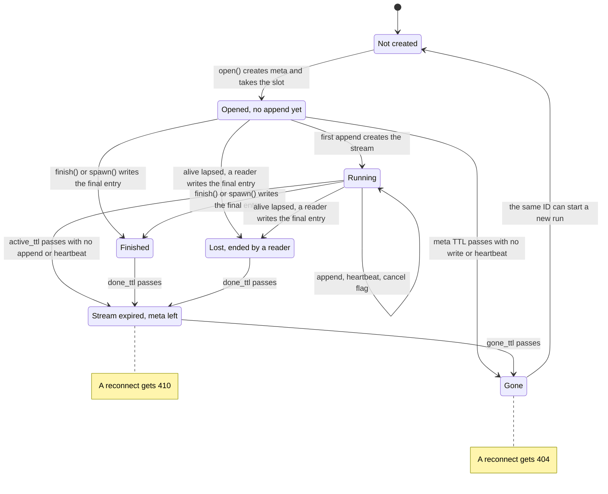
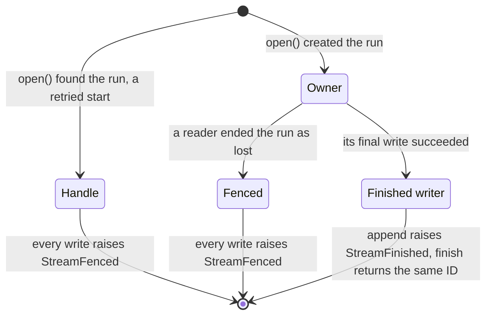
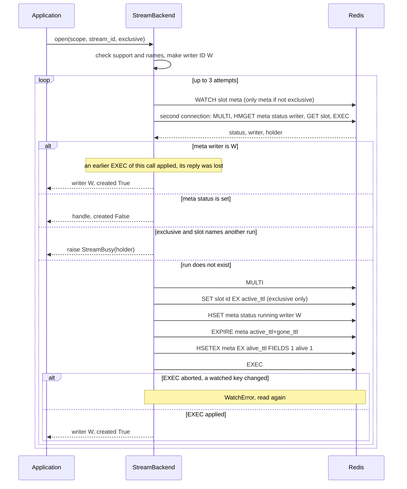
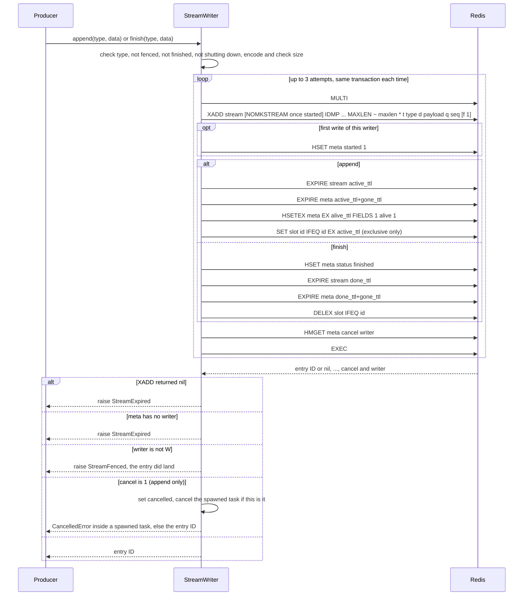
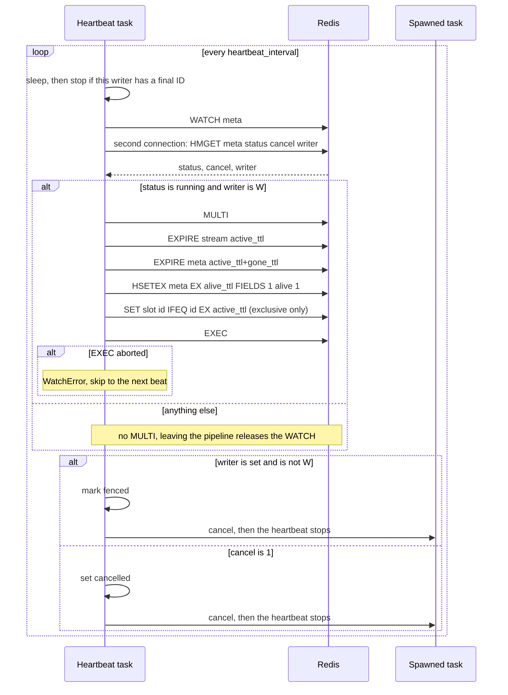
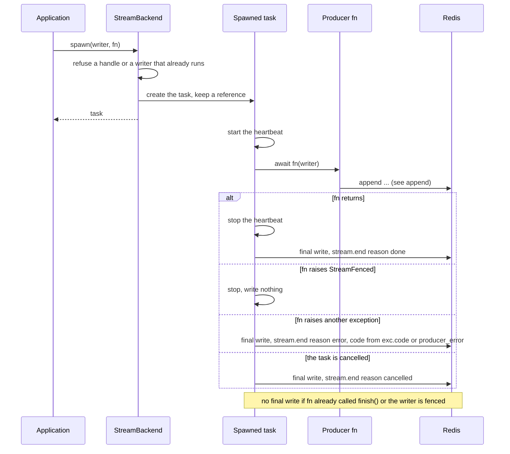
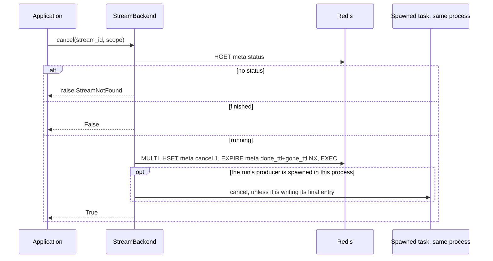
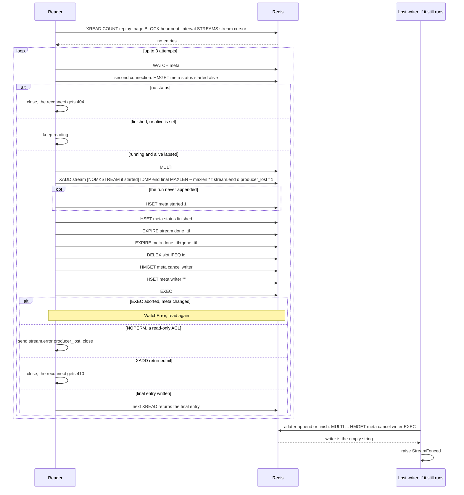

# Resumable streams: the simplified single-owner design

**Status: recorded, not adopted.** Written on 2026-10-30, when the branch was
reset to PR #99, which at that moment carried a process-lease design; the PR
then moved on to one key per run, which is what `resumable-streams-design.md`
describes (section 14, decision 4). This document keeps the alternative that
was built and tested the same day, so the choice can be revisited with every
design in view. Its code is not in the tree.

It started from the `feature/resumable-streams` design (one `alive` heartbeat
field per run, `attach()`, `extend()`) and removed rather than added: one
producer per run, no hand-off, every write one `MULTI`. Against the test file
written for it, it passed 39 tests with one strict `xfail` for its one known
limit; the whole suite passed. The settings, keys and public API of the
`feature/resumable-streams` design were unchanged except for the two removed
methods. The diagrams drop the `stream_` prefix of the settings: `active_ttl`
means `stream_active_ttl`.

## The design in one paragraph

A run has one producer: the process that opened it writes all of it. Every
write is one `MULTI`/`EXEC`, and an append costs one round trip. Three
operations must read before they write - `open()`, the heartbeat, and a
reader ending a lost run - and each is one optimistic transaction under
`WATCH`. A writer loses its run in exactly one way: its heartbeat lapsed and a
reader ended the run as `producer_lost`. There is no hand-off of a running
stream to another process.

## Terms

| Term | Meaning |
|------|---------|
| run | One producer's output, for example one agent turn. One run has one stream and one meta hash. |
| stream | The Redis Stream that holds the run's entries. |
| meta | The hash that holds the run's state. It outlives the stream. |
| slot | The scope's active-run key. A run opened with `exclusive=True` holds it. |
| writer | A `StreamWriter`. Each writer has a random writer ID (`_new_writer_id()`). Meta names the one writer that owns the run. |
| handle | The writer `open()` returns for a run that already exists: a retried start. It never writes. |
| heartbeat | The `alive` field of meta, which has its own TTL, and the `keepalive()` task that refreshes it. |
| final entry | The one entry with `f = 1`. Readers stop after it. |
| fenced | A writer that does not own the run: a handle, or a writer whose run a reader ended. Its writes raise `StreamFenced`. |

## Redis keys

All keys start with the SDK's `prefix` setting.

| Key | Type | Content |
|-----|------|---------|
| `<prefix>:stream:{<scope>}:<id>` | Stream | The entries. Fields: `t` (type), `d` (payload), `q` (writer sequence number), `f` (`1` on the final entry only). |
| `<prefix>:stream-meta:{<scope>}:<id>` | Hash | The run's state. See the next table. |
| `<prefix>:stream-active:{<scope>}` | String | The slot. Its value is the stream ID of the scope's active run. |

The `{<scope>}` hash tag puts all three keys in one Cluster slot, so one
`MULTI` can cover all of them. `check_name()` refuses braces in a scope or an
ID, so no value can break out of the tag.

### Meta fields

| Field | Values | Written by |
|-------|--------|------------|
| `status` | `running`, `finished` | `open()` sets `running`. A final write sets `finished`. |
| `writer` | a writer ID, or `""` | `open()` sets it. A reader that ends a lost run sets `""`. |
| `started` | `1` | The writer's first write, or a reader that ends a run that never appended. |
| `cancel` | `1` | `cancel()`. |
| `alive` | `1`, with its own field TTL | `HSETEX` from `open()`, every append and every heartbeat. `HSETEX` sets the field's TTL and leaves the key's TTL alone. |

Meta without a `status` field counts as no meta. A late append on an expired
run can recreate meta with only `alive` and `started` in it; readers answer
`404` for it, and it expires on its own.

### TTLs in each state

| State | stream | meta (key TTL) | `alive` field | slot (`exclusive=True` only) |
|-------|--------|----------------|---------------|------------------------------|
| After `open()`, no append yet | absent | `active_ttl + gone_ttl` | `alive_ttl` | `active_ttl` |
| After an append or a heartbeat | `active_ttl` | `active_ttl + gone_ttl` | `alive_ttl` | `active_ttl` |
| Finished (by the writer) | `done_ttl` | `done_ttl + gone_ttl` | runs out, nobody reads it | deleted |
| Lost (ended by a reader) | `done_ttl` | `done_ttl + gone_ttl` | lapsed | deleted |
| Stream expired, meta left | absent | what is left, at most `gone_ttl` | - | - |
| Gone | absent | absent | - | - |

An append and a heartbeat set the same TTLs: `_keep_running()` queues them
for both. A final write sets the finished TTLs:
`_mark_finished()`.

With the defaults (`active_ttl` 600, `done_ttl` 120, `gone_ttl` 3600,
`alive_ttl` 45), a finished stream is readable for 2 minutes, and its meta
stays for 62 minutes.

## Run lifecycle

In Redis, "Lost" is the same as "Finished": `status` is `finished` and the
stream has a final `stream.end` entry with `{"reason": "producer_lost"}`. The
difference is that `writer` is `""`.

What a reader gets in each state (`_prepare()`):

| State | Reader result |
|-------|---------------|
| Not created, Gone, or meta without `status` | `StreamNotFound`, `404` |
| Opened | An empty read that waits for entries |
| Running | Replay, then live entries |
| Finished or Lost | Replay up to the final entry, or `204` when the cursor is at or past it |
| Stream expired, meta left | `StreamExpired`, `410`, because `started` is `1` and the stream is absent |

### Writer states

A handle is fenced from the start: `open()` builds it with `created=False`,
and `_fenced` is `not created`. An owner learns that
it is fenced in one of two ways: a write reads a `writer` that is not its own,
or a heartbeat does. From then on `_check_writable()` refuses every write
before it reaches Redis.

## Retries

One policy, `_attempts()`, runs every transaction that is safe to repeat
:

- It tries up to 3 times (`_WRITE_ATTEMPTS`).
- After a timeout or a dropped connection, Redis may or may not have applied
  the writes. It waits 50 ms, then 100 ms, and runs the same transaction
  again. The third failure raises `StreamStoreError`.
- A `WatchError` - a watched key changed before `EXEC` - uses up an attempt and
  retries at once. Three in a row raise `StreamStoreError`.
- Any other Redis error raises `StreamStoreError` at once.

Every write is safe to repeat: appends reuse the IDMP pair `(W, seq)`, final
writes reuse `("end", "final")`, `open()` recognises its own applied `EXEC`
by its writer ID, and `HSET`, `EXPIRE`, `SET IFEQ` and `DELEX IFEQ` give the
same result twice.

`append()`, `finish()` and `cancel()` go through `_transaction()`, one plain
`MULTI` under this policy. `open()` goes through
`_attempts()` with its `WATCH`. The heartbeat and
the reader's end run once per beat; a failed beat is simply the next beat's
job.

## Operations

### `open()`

`open()` creates a run in one optimistic transaction. `start()` calls `open()`
and then `spawn()`, but only when `created` is `True`
.

**Result in Redis.** Meta holds `status=running`, `writer=W` and `alive`, with
the TTLs of the "Opened" row above. With `exclusive=True` the slot names the
run. No stream key exists yet. A retried start changes nothing.

**Errors.** `StreamInvalidName`, `StreamBusy` (the slot names another run),
`StreamUnsupported`, `StreamStoreError` (Redis failed, or the keys changed
three times).

**Before.** Meta for this ID has no `status`. With `exclusive=True` the slot is
free, or names this same ID.

**After.** The slot and meta appear together or not at all: both are in one
`MULTI` under `WATCH`. A retried start returns a handle, which can write
nothing, so a run has one producer. A retried call whose own `EXEC` applied
gets `created=True` back, because meta names its own writer ID
.

**Takeover.** If the slot names this ID but meta is gone (expired or evicted),
`open()` creates the run again and takes the slot. The old producer, if it
still runs, reads a different `writer` at its next write or heartbeat and is
fenced. This needs meta to vanish before the slot, which only eviction does.

### `append()` and `finish()`

Both are the same write, `_write()`. The final
one adds `f=1`, sets `status=finished`, applies the finished TTLs and frees
the slot. Both learn `cancel` and `writer` from the last command of the same
transaction, so the owner check costs no extra round trip.

The IDMP pair is `(W, seq)` for an append and `("end", "final")` for every
final entry. The first write of a writer
omits `NOMKSTREAM`, so it creates the stream. Every later write sends it
.

**Result in Redis.** One new entry. An append sets the "After an append" TTLs
with plain `EXPIRE` and `SET EX`. A finish sets the "Finished" TTLs and
deletes the slot if it still names this run.

**Errors.**

- `ValueError`: the type is empty, too long, has CR, LF or NUL, or starts with
  `stream.`; the coder cannot encode the data; the payload is larger than
  `stream_max_event_bytes`.
- `StreamFinished`: `append()` after this writer wrote its final entry. The
  check is local. `finish()` never raises it: a second call returns the cached
  final ID and sends nothing.
- `StreamFenced`: the writer is a handle, was fenced earlier, or this write
  found another writer in meta.
- `StreamExpired`: the stream expired (`XADD NOMKSTREAM` returned nil), or meta
  is gone.
- `StreamStoreError`: Redis failed three times.
- `asyncio.CancelledError`: from `append()` inside a spawned task, when the run
  has a cancel flag or the backend is shutting down (,
  `499-503`).

**After.** The sequence number `q` grows by one for each successful write. A
retried write after a lost reply sends the same IDMP pair, and Redis returns
the first entry's ID instead of storing a second copy. A retried `finish()`
whose first `EXEC` applied finds its own writer ID still in meta, because the
final write does not change `writer`, and gets the stored final entry's ID.

The owner check runs after the write, in the same transaction. So a writer
whose run a reader ended can still land one entry, after the reader's final
entry, and only then learns that it is fenced. A `finish()` by such a writer
lands nothing: its `XADD` carries the same IDMP pair as the reader's final
entry, so Redis returns that entry's ID, and the `writer` of `""` turns the
call into `StreamFenced` (see [Known limits](#known-limits)).

### Heartbeat: `keepalive()`

`keepalive()` starts a task that runs `_beat()` while the block runs.
`spawn()` wraps the producer in it.

**Result in Redis.** For a running run that this writer owns: the same TTLs an
append sets. `EXPIRE` never creates a key, so a beat cannot bring back an
expired stream, and no `MULTI` runs for a run with no meta, so a beat cannot
recreate meta. For any other run, nothing.

**Errors.** None reach the caller. A `WatchError` or a Redis error skips the
beat. The next beat reads meta again.

**Before and after.**

- Only a beat that reads `status=running` and its own `writer` renews, and
  `WATCH` makes `EXEC` abort if meta changed after that read. So a beat never
  renews a run that ended in between, and never stretches a finished run's
  retention.
- No beat runs after this writer finished: the beat checks the final ID after
  each sleep, and `spawn()` stops the heartbeat before it writes the final
  entry.
- A live producer that does not append keeps its stream: each beat sets the
  stream TTL back to `active_ttl`.
- If meta is gone, `writer` reads as `None`. The beat neither renews nor stops.
  The next write raises `StreamExpired`.

### `spawn()`

The final write goes through `_end()`, the same path as `finish()`. Before it
starts, the task sets `_ending`, so a repeated cancel from `cancel()` or
shutdown does not interrupt it.
`StreamFenced` from the final write is ignored: a reader ended the run already.
Other stream and Redis errors are logged, and readers later see the run as
lost.

The task is cancelled by `cancel()` in the same process, by a heartbeat that
saw a cancel flag or a fence, by an append that read a cancel flag, and by
shutdown.

An exception's `code` attribute becomes the reason code when it is a string.
Stream exceptions carry one, so a producer that lets `StreamExpired` escape
gets `{"reason": "error", "code": "stream_expired"}`. That final write then
fails too, since the stream is gone, and is logged.

**Shutdown.** `aclose()`:

1. It sets `_closing`, so an append inside a spawned task raises
   `CancelledError`.
2. It yields once, so a task spawned a moment ago starts before it is
   cancelled.
3. It cancels every task that is not writing its final entry.
4. It waits up to 5 s, and repeats the cancel every 0.25 s for tasks that are
   still running.
5. After 5 s it logs a warning. Readers of those runs see `producer_lost`.

**Errors.** `ValueError` for a handle or a writer that already runs.

### `cancel()`

**Result in Redis.** Meta has `cancel=1`. TTLs do not change. A producer in
another process sees the flag at its next append (the `HMGET` at the end of
the transaction) or heartbeat. A producer you run yourself, without `spawn()`,
must check `writer.cancelled` and call `finish()`.

**Errors.** `StreamInvalidName`, `StreamNotFound`, `StreamUnsupported`,
`StreamStoreError`.

### A reader ends a lost producer

A reader in `_pages()` blocks for `heartbeat_interval` at a time. After a full
block with no entries it calls `_check_producer()`.

The read repeats on `WatchError` because reading a lapsed `alive` field makes
Redis delete it, and that deletion counts as a change to meta. The second
read finds the field gone and the `EXEC` applies. When `started` is not `1`,
the `XADD` omits `NOMKSTREAM`, so a run that never appended gets a stream that
holds only the final entry.

**Result in Redis.** The same as a finish, plus `writer=""`. Every other
reader stops at the final entry. A reconnect gets `204`. The lost producer, if
it comes back, is fenced at its next write or heartbeat.

**After.** Because the read and the write are one optimistic transaction, a
producer that writes between them is not ended: its append or finish changes
meta, `EXEC` aborts, and the next read sees a fresh `alive` or a finished run.

## Timing

| Setting | Default | Role |
|---------|---------|------|
| `stream_heartbeat_interval` | 15 | How often the heartbeat runs. Also how long a reader blocks before it checks the producer. |
| `stream_alive_ttl` | 45 | TTL of the `alive` field. `.streams()` refuses a value not above `stream_heartbeat_interval`. |
| `stream_active_ttl` | 600 | TTL of a running stream and of the slot, set by every append and heartbeat. |
| `stream_done_ttl` | 120 | TTL of a stream after its final entry. |
| `stream_gone_ttl` | 3600 | How much longer meta lives than the stream. This is the `410` window. |

The rules between them:

- `alive_ttl > heartbeat_interval`, enforced. With the defaults a producer can
  miss two beats before it looks dead.
- `active_ttl` should be well above `heartbeat_interval`. Nothing enforces it.
  If it is not, the stream of a live run that does not append expires between
  beats.
- A reader ends a dead producer's run between `alive_ttl` and
  `alive_ttl + heartbeat_interval` after the producer's last write: 45 to 60 s
  with the defaults. With no reader connected, nobody ends it, and the stream
  expires `active_ttl` after the last write.
- A finished stream is readable for `done_ttl`. Meta stays for
  `done_ttl + gone_ttl`. In that time a retried start finds the run and
  returns a handle.

A producer that dies after its last append at time 0:

```mermaid
gantt
    title Dead producer with one reader, default settings
    dateFormat HH:mm:ss
    axisFormat %H:%M
    section Producer
    last append, then the process dies   :milestone, m0, 00:00:00, 00:00:00
    section alive field
    alive                                :a0, 00:00:00, 00:00:45
    section Reader
    blocking reads, 15 s each            :r0, 00:00:00, 00:00:45
    next empty read ends, reader ends the run :crit, r1, 00:00:45, 00:01:00
    section stream
    readable, final entry at most at 60 s :s0, 00:00:00, 00:03:00
    section meta
    410 window after the stream expires  :g0, 00:03:00, 01:03:00
```

## Invariants

| Invariant | Holds | Where |
|-----------|-------|-------|
| A run has one producer. | Yes | `open()` creates meta and the slot under `WATCH`, and a retried start gets a handle that is fenced from the start. Nothing hands a running stream to another writer. |
| A stream has at most one final entry. | Inside the IDMP window | Every final write, a writer's or a reader's, uses the IDMP pair `("end", "final")`. |
| A write never recreates an expired stream. | Once the writer has started | `NOMKSTREAM` after the writer's first write. |
| Readers never see an entry after the final entry. | Yes | `_pages()` stops at the final entry. `_prepare()` returns `204` when the cursor is the final entry, or when the run is finished and no final entry follows the cursor. |
| A heartbeat never touches a run its writer does not own. | Yes | The beat checks `status` and `writer` under `WATCH`. |
| A reader never ends a run whose producer is writing. | Yes | The reader's end checks `alive` under `WATCH`. |
| A stale writer never frees a newer run's slot. | Yes | `DELEX ... IFEQ` and `SET ... IFEQ` act only while the slot names this run. |
| Meta outlives the stream by `stream_gone_ttl`. | Yes, while both exist | Every transaction that sets the stream TTL to `T` sets meta to `T + gone_ttl` in the same `MULTI`. Eviction can still remove meta first. |
| Every retried write is idempotent. | Yes | Appends reuse `(W, seq)`, final writes reuse `("end", "final")`, `_create()` detects its own applied `EXEC`. The other commands give the same result when repeated. |
| No heartbeat runs after the writer finished. | Yes | `_beat()` checks the final ID after each sleep, and its `WATCH` aborts a beat that races the final write. |
| A retried `finish()` whose reply was lost returns its own final ID. | Inside the IDMP window | The final write leaves `writer` unchanged, so the retry is still the owner, and IDMP returns the stored ID. |

## Known limits

These follow from the code as it is. None of them lets a reader see an entry
after the final entry.

**A fenced append lands after the final entry, and stretches retention.** The
append checks the owner after the write, in the same transaction. After a
reader ended the run, the old producer's one entry lands after the final
entry, where no reader looks, and the same transaction runs
`EXPIRE stream active_ttl` and `EXPIRE meta active_ttl+gone_ttl`
. On a finished run this raises the stream TTL
from at most `done_ttl` to `active_ttl`, and sets `alive`, which nothing reads
any more. `SET ... IFEQ` cannot revive the slot, because `DELEX` deleted it
and `IFEQ` never creates a key. Preventing this would need `WATCH` on every
append, which the design rejects; the test
`test_a_stale_append_never_stretches_a_finished_run` records it as a strict
`xfail`.

**A failed append leaves its sequence number in use.** `_write()` stores the
new `seq` only on success. If all three attempts fail
with `StreamStoreError` but the first one did apply, the next append uses the
same IDMP pair `(W, seq)`. Redis then returns the earlier entry's ID and does
not store the new event, whatever its data. Retrying the same event is safe.
Appending a different event after a `StreamStoreError` can lose it with no
error.

**Idempotency lasts only as long as the IDMP window.** The SDK does not call
`XCFGSET`, so each stream uses the server's IDMP defaults. A retry inside
`_attempts()` comes within about 150 ms and is safe. A final write sent later
than the window can add a second final entry: for example a `finish()` by a
lost producer that comes back after the window. Readers still stop at the
first final entry, so they see no difference, but the stream holds two and
its TTL is reset to `done_ttl`.

**A writer that never appended can create a stream.** Its `_started` is
`False`, so its first write omits `NOMKSTREAM`. Two cases:

- A reader ended the run (the stream holds only the final entry) and that
  stream expired. The writer's first append creates the stream again with one
  ordinary entry, and is fenced. Meta says `finished`, so a reconnect gets
  `204`.
- Meta expired before the first append. The append creates a stream with one
  entry and a meta with `started` and `alive` but no `status`, and raises
  `StreamExpired`. Readers get `404`, and both keys expire on their own.

**`cancel()` can leave a flag for a later run.** It reads `status`, then sets
`cancel` in a second step. If meta expires
between the two, `_set_meta()` creates a meta that holds only `cancel=1`. A new
run with the same ID within `done_ttl + gone_ttl` starts with the flag set and
is cancelled at its first append or heartbeat. This needs meta to expire in a
window of one round trip.

**A reader can wait on a finished run whose stream is gone.** `_check_producer()`
returns "quiet" for `status=finished` without checking that the stream exists
. If the stream expired, or the final write
found it gone, an open reader waits until `stream_max_connection_duration`
closes the connection. The reconnect then gets `410`.

**A field expiry can skip one beat.** Redis removes a lapsed hash field when
it is read or by its active expiry cycle, and that removal counts as a change
to meta. A beat whose `WATCH` catches it skips its renewal; the next beat,
15 s later, renews. The reader's end repeats its read in place for the same
reason.

## Why it was set aside, and what it kept

Compared with the process-lease iteration of PR #99 (`085764f`), against
which the decision was taken. PR #99's final design, one key per run, drops
the metadata hash and the lease as well; the design spec describes it.

| | This design | PR #99, lease iteration |
|---|---|---|
| Commands per append | ~7 (entry, four TTL refreshes, the heartbeat, one read) | 2 (entry, one read) |
| Heartbeat | One `WATCH` transaction per run per 15 s | One transaction per process per 15 s |
| Key kinds | 3 | 5 (adds a lease and a cancel set per process) |
| Liveness check | On the run's own meta, inside the reader's `WATCH` | On the owner's lease, another slot, outside the `WATCH` |
| Failure scope of a missed renewal | The run whose command failed | Every run of the process |
| Owner check on append | Yes: a writer that lost its run is fenced | No: only `status` and `cancel` are read |
| A dead holder's scope freed with no reader | After `stream_active_ttl` (10 min) | After `stream_lease_ttl` (45 s) |
| Hand-off between processes | None | `suspend()` / `resume()` |
| Stale append stretches a finished run | Yes, once (the strict `xfail`) | No TTL writes on append |
| Settings and exceptions changed | None | Three settings, `StreamFenced` removed |

It was set aside for the hot path and for multi-process operation: PR #99
writes two commands per append and frees a crashed process's scopes within a
minute without a reader. What it did better, and what PR #99's phase 2 list
(design section 15) inherits as issues: the liveness check sits inside the
same `WATCH` as the reader's end, a run's keys never leave their slot, a
failure is per run, and an append reads `writer`, so a producer that comes
back after losing its run cannot keep writing.

## How it could have grown

An evolution was sketched, not built, that would have taken PR #99's two
real wins without the lease:

1. **Creation-time TTLs and a two-command append.** Set every TTL at `open()`
   (`stream_max_run`), renew past half the lifetime, and write a hidden
   `stream.start` entry so the stream exists from `open()`; `append()` becomes
   `XADD` plus `HMGET`, the `started` field goes, and the stale-append limit
   disappears. A reader counts a recent last entry as proof of life, so the
   `alive` field matters only for an idle producer.
2. **One renewal task per process, still one `alive` per run.** Renew every
   live writer's field in one pipelined round trip every 15 s, from a weak
   set, chunked. O(runs) small commands, one wait, with liveness still on the
   run's key and inside the reader's `WATCH`.
3. **`open()` takes over a dead holder's slot** when the holder's `alive`
   lapsed, ending its run as `producer_lost` in the same transaction.
4. **`suspend()` / `resume()`** with the same shape PR #99 has.

O(1) heartbeat commands per process were judged incompatible with per-run
liveness: a key written once per process cannot sit in a run's slot. At the
run counts an agent workload reaches, the O(runs) cost does not register.
